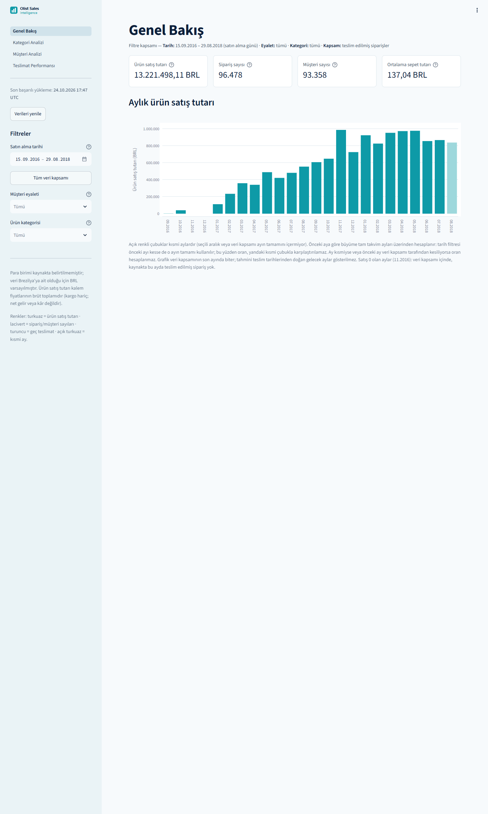
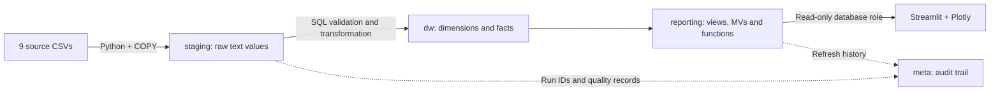

# Olist Sales Intelligence

**A local sales data warehouse and SQL reporting dashboard.**

**PostgreSQL 16 · Python 3.11 · Docker Compose · SQLAlchemy · pandas · Streamlit · Plotly · pytest**

[English](#english) · [Türkçe](#turkce) · [Architecture / Mimari](#architecture) · [Documentation / Belgeler](#documentation)

9 source CSVs · 99,441 orders · 112,650 order items · 4 dashboard pages

<details>
<summary><strong>Dashboard preview / Panel ön izlemesi</strong></summary>



Default scope: delivered orders purchased between 15 September 2016 and 29 August 2018. The application interface is in Turkish; this README is bilingual.

Varsayılan kapsam: 15 Eylül 2016–29 Ağustos 2018 arasında satın alınmış, teslim edilmiş siparişler. Uygulama arayüzü Türkçedir; bu README iki dillidir.

| Page / Sayfa | Screenshot / Ekran görüntüsü |
|---|---|
| Overview / Genel Bakış | [Desktop](docs/screenshots/desktop_genel-bakis.png) · [390 px](docs/screenshots/narrow_genel-bakis.png) |
| Categories / Kategori Analizi | [Desktop](docs/screenshots/desktop_kategori.png) · [390 px](docs/screenshots/narrow_kategori.png) |
| Customers / Müşteri Analizi | [Desktop](docs/screenshots/desktop_musteri.png) · [390 px](docs/screenshots/narrow_musteri.png) |
| Delivery / Teslimat Performansı | [Desktop](docs/screenshots/desktop_teslimat.png) · [390 px](docs/screenshots/narrow_teslimat.png) |

</details>

<a id="architecture"></a>
## Architecture / Mimari



The pipeline, tests and dashboard run in Docker; PostgreSQL data persists in a named volume. No paid cloud service or AI API is required to run the application.

Veri hattı, testler ve dashboard Docker içinde çalışır; PostgreSQL verileri named volume içinde korunur. Uygulamayı çalıştırmak için ücretli bulut servisi veya yapay zekâ API'si gerekmez.

### Runtime / Çalışma ortamı

| Component / Bileşen | Pinned version / Sabit sürüm |
|---|---|
| PostgreSQL | 16.15; image pinned by digest / imaj digest ile sabit |
| Python | 3.11.17; image pinned by digest / imaj digest ile sabit |
| pandas / SQLAlchemy | 3.1.0 / 2.1.6 |
| psycopg2-binary | 2.9.13 |
| Streamlit / Plotly | 1.66.1 / 7.1.0 |
| pytest | 9.1.1 |

Versions are defined in `Dockerfile`, `compose.yaml` and the locked `requirements.txt`. Windows/PowerShell is the validated setup path. Playwright is a verification tool, not an application dependency.

Sürümler `Dockerfile`, `compose.yaml` ve kilitli `requirements.txt` içinde tanımlıdır. Doğrulanmış kurulum yolu Windows/PowerShell'dir. Playwright uygulamanın çalışması için değil, tarayıcı doğrulaması için kullanılır.

<a id="english"></a>
## English

### Overview

Olist Sales Intelligence turns the public Brazilian e-commerce dataset into a PostgreSQL warehouse and a four-page dashboard. It answers questions about monthly sales, category concentration, RFM customer segments, delivery performance and repeat purchases.

The project focuses on metric correctness, reliable loading and measured SQL decisions. Orders, items and payments have separate grains to prevent inflated totals. Customer retention uses `customer_unique_id`, and dashboard values are checked against independent SQL.

### Implementation highlights

- **Reliable full refresh:** source validation, `COPY FROM STDIN`, deduplication, rejected-row records, reporting refresh and quality checks. Failed loads roll back data changes while preserving the failure log.
- **Explicit model:** four dimensions and three facts with primary/foreign keys and constraints. Items, payments and reviews are aggregated separately before combining order-level measures.
- **SQL reporting:** CTEs, window functions, `LAG`, cumulative sums, `ROLLUP`, `GROUPING SETS`, parameterized functions and PL/pgSQL procedures.
- **Dashboard:** overview, category, customer and delivery pages; read-only credentials, explicit filter scope and cached results keyed by the successful load ID.
- **Measured optimization:** isolated experiments, saved plans, repeated timings, result-equivalence checks and documented read/write trade-offs.
- **Recovery:** custom-format PostgreSQL backups and restores verified both in a separate database and a fresh cluster.

### Quick start — Windows / PowerShell

**Prerequisites:** Docker Desktop with a working WSL 2 backend, Docker Compose, Git and PowerShell. Start Docker Desktop and wait for the engine to be ready. Application Python and PostgreSQL run inside Docker.

1. Clone this repository or download and extract its ZIP. Open PowerShell in the repository root.
2. Download the [Olist dataset](https://www.kaggle.com/datasets/olistbr/brazilian-ecommerce) and extract all nine CSVs into `data/raw/`. Kaggle may require account access.
3. Run:

```powershell
.\scripts\new-env.ps1
.\scripts\up.ps1
.\scripts\etl.ps1
.\scripts\test.ps1
.\scripts\dashboard.ps1
```

4. Open [http://127.0.0.1:8501](http://127.0.0.1:8501).

The first build downloads images and Python packages. Credentials are generated in the ignored `.env` file. Preserve existing credentials when reusing a database volume.

<details>
<summary>Required source files</summary>

```text
data/raw/
├── olist_customers_dataset.csv
├── olist_geolocation_dataset.csv
├── olist_order_items_dataset.csv
├── olist_order_payments_dataset.csv
├── olist_order_reviews_dataset.csv
├── olist_orders_dataset.csv
├── olist_products_dataset.csv
├── olist_sellers_dataset.csv
└── product_category_name_translation.csv
```

Raw data is intentionally excluded from Git. Synthetic fixtures are included for tests.

</details>

On subsequent sessions, start Docker Desktop, then run `up.ps1` and `dashboard.ps1`. Reload with `etl.ps1` when source data changes. `down.ps1` stops the project and preserves its volume; `reset.ps1` is a separate destructive reset.

### Data model and metrics

| Layer | Purpose |
|---|---|
| `staging` | Source columns and raw text values with source row identifiers |
| `dw` | `dim_customer`, `dim_product`, `dim_seller`, `dim_date`; `fact_orders`, `fact_sales`, `fact_payments` |
| `reporting` | Business metrics, dashboard functions, materialized views and monthly summaries |
| `meta` | Migration, ETL, file, rejected-row, quality and refresh records |

One fact row represents an order, order item or payment respectively. The model uses `customer_unique_id` for people, rather than the order-specific `customer_id`.

- Sales include only `order_status = 'delivered'`; other statuses remain in the warehouse.
- Product sales exclude freight. Product sales, payments, freight and profit are different concepts. Profit and refund-adjusted revenue are not calculated because costs and refund details are unavailable.
- **BRL is a documented currency assumption.** Source timestamps have no timezone and are preserved without timezone conversion.
- The sales observation window comes from delivered purchases. Observed zero-sales months are retained; dates outside that window are not presented as zero sales.
- Monthly bars use selected dates. Growth compares complete calendar-month totals: the full previous month may be used even when its visible bar is cut by the user filter. Coverage-truncated reference months are excluded; the chart explains the distinction.
- RFM requires `as_of`. Historical order-status changes are unavailable, so historical RFM is not a point-in-time status reconstruction.

See the [ER diagram](docs/er_diagram.md), [data dictionary](docs/data_dictionary.md) and [metric definitions](docs/metric_definitions.md).

### Selected real-data results

Delivered-order scope; these are recorded historical dataset results, not current business performance.

| Metric | Result |
|---|---:|
| Delivered orders / unique customers | 96,478 / 93,358 |
| Order items in sales scope | 110,197 |
| Product sales | 13,221,498.11 BRL |
| Average order value, excluding freight | 137.04 BRL |
| Average measured delivery time | 12.56 days |
| Late-delivery rate / repeat-purchase rate | 6.77% / 3.00% |

Eight delivered orders lack a delivery timestamp: they remain in sales metrics but are excluded from delivery-time and late-delivery denominators. The source includes 99,441 orders and 112,650 items across all statuses. Evidence: [independent checks](docs/validation/invariants.json), [dashboard verification](docs/dashboard_verification.json).

### Performance findings

Real data in a separate `olist_perf` database; warm cache; query medians from two warm-ups and seven measured executions. Load medians use one warm-up and five executions.

| Experiment | Before | After | Outcome |
|---|---:|---:|---|
| Customer lookup, B-tree | 12.918 ms | 0.955 ms | Faster reads with additional write/storage cost |
| Undelivered orders, partial index | 15.281 ms | 0.524 ms | Isolated experiment; not added to the main model |
| Repeat-purchase rewrite | Old indexed query: 1,517.952 ms | No extra index: 405.891 ms | Equivalent result; applied in migration `170` |
| Category aggregation / MV read | 568.796 ms | 0.607 ms | Refresh costs about 0.55 s; MV remains stale until refreshed |
| Default `to_sql` / COPY load | 3.716 s | 1.263 s | COPY retained |

The original unindexed repeat-purchase query exceeded 60 seconds; no exact runtime or exact speedup against that timeout is claimed. More `work_mem` did not improve RFM. Partitioning slowed a full-table query and was not adopted. Product/seller indexes were retained after ETL foreign-key checks showed they were needed.

These are individual-query measurements from specific migration versions, not whole-application speedups. Sub-millisecond measurements are noisy. [Methodology and trade-offs](docs/performance.md) · [Raw measurements](docs/perf/results/) · [Query plans](docs/perf/plans/).

### Validation and operations

The recorded validation snapshot on **25 October 2026** includes **89 passing pytest tests**. This is a local result, not a GitHub Actions/CI badge.

- Synthetic fixtures cover manually calculated totals, malformed input, duplicate/conflicting keys, date boundaries, repeat loading and rollback.
- Seven real-data dashboard filter cases match independent SQL.
- Clean installation was tested in an isolated Compose project.
- Browser checks covered four pages at 1440 px and 390 px, filters and empty results; later overview changes were checked separately.
- Backup restores were compared with the source and verified in a fresh cluster.

```powershell
.\scripts\test.ps1
.\scripts\etl.ps1 verify
.\scripts\verify-dashboard.ps1
.\scripts\etl.ps1 runs --limit 5
.\scripts\backup.ps1
```

Additional checks: `validate-clean-install.ps1`, `perf.ps1 --rebuild` and `screenshots.ps1 -LocalChrome`, all under `scripts/`. The local screenshot route additionally requires host Python and Chrome; the Docker route needs downloads. See [dashboard validation](docs/dashboard.md) and [the validation report](docs/validation_report.md).

Backups and matching SHA-256 files are written to the ignored `backups/` directory. After creating a backup, select the newest dump and restore it to a separate test database:

```powershell
$latestBackup = Get-ChildItem .\backups\*.dump | Sort-Object LastWriteTime -Descending | Select-Object -First 1
if ($null -eq $latestBackup) { throw 'No backup found. Run backup.ps1 first.' }
.\scripts\restore.ps1 -BackupFile $latestBackup.FullName -TargetDatabase olist_restore_test
.\scripts\verify-restore.ps1 -BackupFile $latestBackup.FullName -TargetDatabase olist_restore_test
```

The target must be new or empty; the restore script refuses to overwrite a populated database. If a previous restore test already populated that target, choose another test database name and use it consistently in both commands. Cluster roles, passwords and `.env` are not all contained in a database dump; the scripts reconstruct the required role setup. [Restore evidence](docs/validation/backup_restore_check.json) · [Fresh-cluster verification](docs/validation/backup_restore_fresh_cluster.json). Keep a backup copy outside the source disk.

### Limitations, licensing and support

- Local portfolio/demo scope; no production deployment or multi-user load validation.
- Full refresh only; no incremental ingestion, scheduler or real-time stream.
- Historical status snapshots and verified currency/timezone metadata are unavailable.
- Rejection rules were exercised on synthetic data; the real-data load produced no rejected rows.
- Performance: one machine, warm cache and one user.
- Browser checks: Chromium, 1440 px and 390 px. Other browsers, intermediate widths and accessibility were not fully assessed.
- Backups are manual; the Docker screenshot route needs internet. Some index decisions remain open in the performance report.

#### Publishing the source

Version the source code, SQL, scripts, synthetic fixtures, documentation, screenshots and verification artifacts. Include `.env.example` and `.gitignore`. Keep `.env`, raw CSVs, database dumps, virtual environments and temporary files local. A ZIP of the entire working folder may contain those files even when `.gitignore` is correct: ignore rules govern Git tracking, not ZIP creation or arbitrary file uploads. Review the actual staged file list before the first push. Never upload the complete working-folder ZIP as a project asset.

**Dataset:** [Brazilian E-Commerce Public Dataset by Olist](https://www.kaggle.com/datasets/olistbr/brazilian-ecommerce), version 2, published by Olist, licensed under [CC BY-NC-SA 4.0](https://creativecommons.org/licenses/by-nc-sa/4.0/). Attribution, non-commercial and share-alike conditions apply to licensed data and relevant adaptations. Raw CSVs and database dumps are not distributed here.

**Project code:** no code license has been selected. The dataset license is not the code license; do not assume a permissive open-source code license has been granted.

For setup/reproducibility questions, use this repository's Issues tab with the failing command and a sanitized error. Do not attach credentials, source data or dumps.

[Back to top](#olist-sales-intelligence) · [Türkçe](#turkce)

---

<a id="turkce"></a>
## Türkçe

### Proje hakkında

Olist Sales Intelligence, Brezilya e-ticaret verisini PostgreSQL veri ambarına yükleyip dört sayfalık bir panelde sunan yerel portföy projesidir. Aylık satış ve büyüme, kategori payı, RFM müşteri segmentleri, teslimat performansı ve tekrar satın alma sorularını yanıtlar.

Odak noktası metrik doğruluğu, güvenilir yükleme ve ölçüme dayalı SQL kararlarıdır. Sipariş, kalem ve ödeme düzeyleri ayrılır; kişi sayımı `customer_unique_id` ile yapılır; panel sonuçları bağımsız SQL sorgularıyla karşılaştırılır.

### Öne çıkan özellikler

- **Güvenilir tam yenileme:** dosya kontrolleri, COPY, tekrar ayrımı, gerekçeli ret kayıtları, rapor yenileme ve kalite kontrolleri. Başarısız yükleme geri alınır; hata kaydı korunur.
- **Açık model:** dört boyut ve üç olgu tablosu; sipariş, kalem ve ödeme için ayrı ayrıntı düzeyleri; PK/FK ve veri kısıtları. Kalem, ödeme ve yorumlar ayrı toplanarak join çoğalması önlenir.
- **İleri SQL:** CTE, window function, `LAG`, kümülatif toplam, `ROLLUP`, `GROUPING SETS`, parametreli fonksiyonlar ve PL/pgSQL prosedürleri.
- **Tutarlı panel:** dört sayfa, salt okunur rol, parametreli sorgular, açıklanmış filtre kapsamı ve başarılı yükleme kimliğine bağlı önbellek.
- **Kanıtlı performans çalışmaları:** ayrı veritabanında deneyler, çalışma planları, tekrarlı ölçümler ve okuma/yazma maliyetleri.
- **Geri dönüş:** özel biçimli PostgreSQL yedekleri, bütünlük kontrolü ve ayrı veritabanı/yeni kümede doğrulanmış geri yükleme.

### Hızlı başlangıç — Windows / PowerShell

**Gereksinimler:** WSL 2 altyapısıyla çalışan Docker Desktop, Docker Compose, Git ve PowerShell. Docker Desktop'ı açıp motorun hazır olmasını bekleyin. Uygulama Python'u ve PostgreSQL Docker içinde çalışır.

1. Depoyu klonlayın veya ZIP olarak indirip çıkarın. PowerShell'i proje kökünde açın.
2. [Olist veri setini](https://www.kaggle.com/datasets/olistbr/brazilian-ecommerce) indirip dokuz CSV'yi `data/raw/` içine çıkarın. Kaggle hesap erişimi isteyebilir.
3. Sırayla çalıştırın:

```powershell
.\scripts\new-env.ps1
.\scripts\up.ps1
.\scripts\etl.ps1
.\scripts\test.ps1
.\scripts\dashboard.ps1
```

4. [http://127.0.0.1:8501](http://127.0.0.1:8501) adresini açın.

İlk derlemede imajlar ve paketler indirilir. Parolalar Git dışındaki `.env` içinde üretilir. Mevcut volume ile aynı kimlik bilgilerini koruyun. Gerekli dosyalar:

```text
olist_customers_dataset.csv
olist_geolocation_dataset.csv
olist_order_items_dataset.csv
olist_order_payments_dataset.csv
olist_order_reviews_dataset.csv
olist_orders_dataset.csv
olist_products_dataset.csv
olist_sellers_dataset.csv
product_category_name_translation.csv
```

Ham veriler Git dışında, sentetik test verileri depo içindedir. Sonraki kullanımlarda Docker Desktop'ı açıp `up.ps1` ve `dashboard.ps1` çalıştırın. CSV değişirse ETL'i yeniden çalıştırın. `down.ps1` veriyi koruyarak kapatır; `reset.ps1` verileri silen ayrı bir sıfırlamadır.

### Veri modeli ve metrik kuralları

| Katman | Görev |
|---|---|
| `staging` | Kaynak kolonlarını ve ham metin değerlerini kayıt sırasıyla saklar |
| `dw` | Müşteri, ürün, satıcı ve tarih boyutları; sipariş, kalem ve ödeme olguları |
| `reporting` | İş metrikleri, panel fonksiyonları, materialized view'ler ve aylık özetler |
| `meta` | Migration, ETL, dosya sayımı, ret, kalite ve yenileme kayıtları |

`fact_orders` satırı bir sipariş, `fact_sales` satırı bir kalem, `fact_payments` satırı bir ödeme kaydıdır. Kişiyi siparişe özgü `customer_id` yerine `customer_unique_id` temsil eder.

- Satış kapsamı yalnızca `delivered`; diğer durumlar ambar içinde korunur.
- Ürün satış tutarı kargo hariç kalem fiyatları toplamıdır. Ödeme, kargo ve kârla aynı değildir. Maliyet ve iade bilgisi bulunmadığından kâr veya iade sonrası net gelir hesaplanmaz.
- **BRL belgelenmiş bir para birimi varsayımıdır.** Kaynak zamanlar saat dilimi içermediği için dönüşüm yapılmaz.
- Gözlem aralığı teslim edilmiş satın almalardan türetilir. Kapsam içindeki gerçek sıfır aylar korunur; gözlem dışı aylar sıfır gibi gösterilmez.
- Aylık çubuklar seçili günleri, büyüme tam takvim aylarını kullanır. Kullanıcı filtresi önceki çubuğu kesse bile oran tam önceki aya göre hesaplanabilir; veri kapsamı nedeniyle eksik ay referans alınmaz. Arayüz bu ayrımı açıklar.
- RFM için `as_of` zorunludur. Geçmiş sipariş durumları bulunmadığından geçmiş RFM tam bir tarihsel durum rekonstrüksiyonu değildir.

[ER diyagramı](docs/er_diagram.md) · [Veri sözlüğü](docs/data_dictionary.md) · [Metrik tanımları](docs/metric_definitions.md).

### Gerçek veri sonuçları

Teslim edilmiş sipariş kapsamındaki tarihsel veri sonuçlarıdır; güncel ticari performansı temsil etmez.

| Metrik | Sonuç |
|---|---:|
| Teslim edilmiş sipariş / farklı müşteri | 96.478 / 93.358 |
| Satış kapsamındaki kalem | 110.197 |
| Ürün satış tutarı | 13.221.498,11 BRL |
| Kargo hariç ortalama sepet | 137,04 BRL |
| Ortalama ölçülen teslimat süresi | 12,56 gün |
| Geç teslimat / tekrar satın alma oranı | %6,77 / %3,00 |

Teslim zamanı boş 8 sipariş satış kapsamında kalır; teslimat süresi ve geç teslimat paydasına girmez. Kaynakta bütün durumlar dahil 99.441 sipariş ve 112.650 kalem vardır. [Bağımsız kontroller](docs/validation/invariants.json) · [Dashboard doğrulaması](docs/dashboard_verification.json).

### Performans bulguları

Gerçek veri ve ayrı `olist_perf` veritabanı kullanıldı. Sorgular iki ısınma ve yedi ölçümle, yüklemeler bir ısınma ve beş ölçümle sınandı. Değerler sıcak önbellekte alınan medyanlardır.

| Deney | Önce | Sonra | Sonuç |
|---|---:|---:|---|
| Müşteri sorgusu, B-tree | 12,918 ms | 0,955 ms | Okuma hızlandı; yazma ve depolama maliyeti var |
| Teslim edilmemiş siparişler, partial index | 15,281 ms | 0,524 ms | İzole deney; ana modele eklenmedi |
| Tekrar satın alma sorgusunu yeniden yazma | Eski indeksli sorgu: 1.517,952 ms | Ek indekssiz: 405,891 ms | Sonuç aynı; migration `170` ile uygulandı |
| Kategori hesabı / MV okuması | 568,796 ms | 0,607 ms | Yenileme yaklaşık 0,55 s; yenilenene kadar veri eski kalır |
| Varsayılan `to_sql` / COPY | 3,716 s | 1,263 s | COPY korundu |

İlk indekssiz tekrar satın alma sorgusu 60 saniye sınırını aştı; buna karşı kesin süre veya kesin hızlanma katsayısı verilmez. `work_mem` artışı hızlandırmadı. Partitioning bütün tablo sorgusunu yavaşlattı ve uygulanmadı. Ürün/satıcı indekslerinin ETL foreign key kontrolleri için gerekli olduğu ayrıca gösterildi.

Sonuçlar belirli migration sürümlerindeki tekil sorgulara aittir; bütün uygulamanın aynı oranda hızlandığı anlamına gelmez. Milisaniye altı sonuçlar gürültüye açıktır. [Yöntem ve maliyetler](docs/performance.md) · [Ham ölçümler](docs/perf/results/) · [Çalışma planları](docs/perf/plans/).

### Doğrulama ve günlük işlemler

**25 Ekim 2026** tarihli kayıtlı son doğrulamada **89 pytest testi başarılıdır**. Bu yerel sonuçtur; GitHub Actions/CI durumu değildir.

- Sentetik testler elle hesaplanan tutarları, bozuk girdileri, tekrar/çelişkileri, tarih sınırlarını, tekrar yüklemeyi ve rollback davranışını kapsar.
- Gerçek veride yedi örnek filtre doğrudan SQL ile eşleşir.
- Ayrı Compose projesinde temiz kurulum sınanmıştır.
- Dört sayfa 1440 px ve 390 px genişlikte gerçek tarayıcıda kontrol edilmiştir; filtre ve boş sonuç etkileşimleri sınanmıştır. Son Genel Bakış değişiklikleri ayrıca doğrulanmıştır.
- Yedekler ayrı veritabanı ve yeni PostgreSQL kümesinde karşılaştırılmıştır.

```powershell
.\scripts\test.ps1
.\scripts\etl.ps1 verify
.\scripts\verify-dashboard.ps1
.\scripts\etl.ps1 runs --limit 5
.\scripts\backup.ps1
```

Ek kontroller `scripts/` altındaki `validate-clean-install.ps1`, `perf.ps1 --rebuild` ve `screenshots.ps1 -LocalChrome` komutlarıdır. Yerel görüntü yolu bilgisayarda Python ve Chrome ister; Docker yolu indirme gerektirir. [Dashboard belgesi](docs/dashboard.md) · [Doğrulama raporu](docs/validation_report.md).

Yedekler SHA-256 dosyasıyla Git dışındaki `backups/` klasörüne yazılır. Yedek aldıktan sonra en yeni dump dosyasını seçip ayrı test veritabanına geri yüklemek için:

```powershell
$latestBackup = Get-ChildItem .\backups\*.dump | Sort-Object LastWriteTime -Descending | Select-Object -First 1
if ($null -eq $latestBackup) { throw 'Yedek bulunamadı. Önce backup.ps1 çalıştırın.' }
.\scripts\restore.ps1 -BackupFile $latestBackup.FullName -TargetDatabase olist_restore_test
.\scripts\verify-restore.ps1 -BackupFile $latestBackup.FullName -TargetDatabase olist_restore_test
```

Hedef yeni veya boş olmalıdır; betik dolu veritabanının üzerine yazmaz. Önceki deneme hedefi doldurduysa başka bir test adı seçip iki komutta da aynı adı kullanın. Küme rollerinin tamamı, parolalar ve `.env` yedekte değildir; gereken rol kurulumu betiklerde ele alınır. [Geri yükleme kanıtı](docs/validation/backup_restore_check.json) · [Yeni küme doğrulaması](docs/validation/backup_restore_fresh_cluster.json). Yedeklerin bir kopyasını kaynak disk dışında saklayın.

### Sınırlamalar, lisans ve destek

- Yerel portföy/demo kapsamı; canlı ortam ve çok kullanıcılı yük doğrulaması yok.
- Yalnızca tam yenileme; artımlı yükleme, zamanlayıcı veya gerçek zamanlı akış yok.
- Tarihsel durum geçmişi ve doğrulanmış para birimi/saat dilimi metaverisi yok.
- Ret kuralları sentetik veride sınandı; gerçek yüklemede ret çıkmadı.
- Performans tek makine, sıcak önbellek ve tek kullanıcıyla ölçüldü.
- Tarayıcı kontrolü Chromium, 1440 px ve 390 px ile sınırlı; diğer tarayıcılar, ara genişlikler ve erişilebilirlik tam sınanmadı.
- Yedekler elle alınıyor; Docker görüntü yolu internet istiyor. Bazı indeks kararları performans raporunda açık durumda.

#### GitHub paylaşım kapsamı

Kaynak kodu, SQL dosyalarını, betikleri, sentetik test verilerini, belgeleri, ekran görüntülerini ve doğrulama kanıtlarını sürümleyin. `.env.example` ve `.gitignore` depoda bulunsun. `.env`, ham CSV'ler, veritabanı yedekleri, sanal ortamlar ve geçici dosyalar yerelde kalsın. Bütün çalışma klasörünü ZIP yapmak, `.gitignore` doğru olsa bile bu dosyaları arşive ekleyebilir: dışlama kuralları Git takibini yönetir, ZIP oluşturmayı veya gelişigüzel dosya yüklemeyi değil. İlk gönderimden önce gerçekten staged olan dosyaları inceleyin. Çalışma klasörünün tamamını içeren ZIP'i proje eki olarak yüklemeyin.

**Veri:** Olist tarafından yayımlanan [Brazilian E-Commerce Public Dataset](https://www.kaggle.com/datasets/olistbr/brazilian-ecommerce), sürüm 2. Lisans [CC BY-NC-SA 4.0](https://creativecommons.org/licenses/by-nc-sa/4.0/). Lisanslı veri ve ilgili uyarlamalarda kaynak belirtme, ticari olmayan kullanım ve aynı lisansla paylaşım koşulları geçerlidir. Ham CSV'ler ve dump dosyaları depoda dağıtılmaz.

**Proje kodu:** Henüz kod lisansı seçilmemiştir. Veri lisansını kod lisansı olarak yorumlamayın; izin veren açık kaynak kod lisansı verildiğini varsaymayın.

Kurulum ve yeniden üretme soruları için deponun Issues bölümünü kullanın. Hata veren komutu ve gizli bilgilerden arındırılmış mesajı ekleyin; parola, ham veri veya dump paylaşmayın.

[Başa dön](#olist-sales-intelligence) · [English](#english)

<a id="documentation"></a>
## Documentation / Belgeler

| Topic / Konu | Reference / Kaynak |
|---|---|
| Model | [ER diagram](docs/er_diagram.md) · [Data dictionary](docs/data_dictionary.md) |
| Business rules / İş kuralları | [Metric definitions](docs/metric_definitions.md) · [Reporting](docs/reporting.md) |
| Pipeline / Veri yükleme | [ETL pipeline](docs/etl_pipeline.md) |
| Performance / Performans | [Report](docs/performance.md) · [Measurements](docs/perf/results/) · [Plans](docs/perf/plans/) |
| Dashboard / Panel | [Guide](docs/dashboard.md) · [Screenshots](docs/screenshots/) |
| Verification / Doğrulama | [Validation report](docs/validation_report.md) · [Evidence](docs/validation/) |
| Portfolio / Portföy | [CV bullets, TR](docs/cv_bullets_tr.md) · [Interview guide, TR](docs/interview_guide_tr.md) · [Demo script, TR](docs/demo_script_tr.md) |

```text
.
├── dashboard/          # Streamlit pages, filters and charts
├── etl/                # Pipeline, loading and migrations
├── sql/                # Schema, transformations, checks and reports
├── perf/               # Isolated performance experiments
├── validation/         # Independent real-data checks
├── tests/              # pytest and synthetic fixtures
├── tools/              # Browser validation utilities
├── scripts/            # PowerShell entry points and recovery
├── docs/               # Technical documentation and evidence
├── data/raw/           # Source CSVs — ignored
├── backups/            # Database dumps — ignored
├── compose.yaml
├── Dockerfile
└── requirements.txt
```
