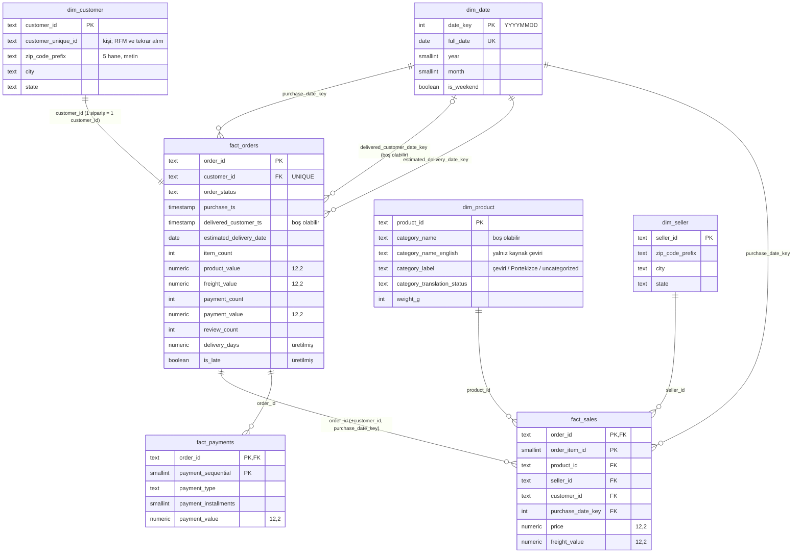
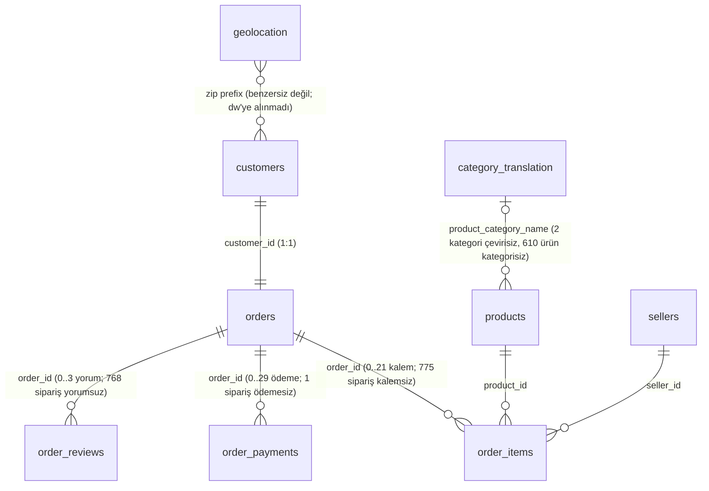

# ER Diyagramı

Yıldız şema (dw) ve kaynak (staging) ilişkileri. Çokluklar `docs/data_profile.md` ölçümlerine dayanır.

## dw katmanı

## Kaynak (staging) ilişkileri ve ölçülen çokluklar

Notlar:

- `customer_unique_id` bir kişiyi temsil eder. 2.997 kişinin birden fazla `customer_id` değeri vardır.
- `order_reviews` anahtarı `(review_id, order_id)` çiftidir; `review_id` tek başına benzersiz değildir.
- `geolocation` tablosu posta kodu öneki başına birden çok satır içerir, bu yüzden boyut olarak modellenmedi ve yalnızca staging'de tutuluyor.
- `meta` şeması (çalışma kaydı, ret kayıtları) bu diyagramda yoktur; ayrıntılar `docs/data_dictionary.md` dosyasında.
